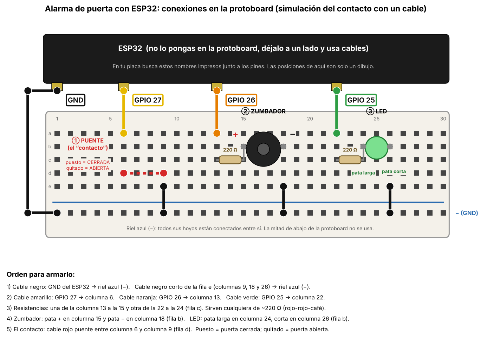

# Alarma de apertura de puerta con ESP32 y MQTT

ITSON · Adquisición Automática de Datos · Actividad final.
Equipo: Emmanuel Enrique Riveros Ramirez, Daniel Aguilar Trillas, Rogelio Beltran Valenzuela, Ely Otoniel Ruiz Gallegos.

Un ESP32 vigila una puerta, suena un buzzer y enciende un LED al abrirse, y publica cada evento por MQTT a un broker Mosquitto
con autenticación y ACL. Un servicio en Python guarda los eventos en SQLite, calcula métricas y muestra un dashboard con control del actuador.

> **Sensor:** contacto magnético MC-38 real en GPIO27 (normalmente abierto: con el imán cerca = cerrada, al alejarlo = abierta). No tiene polaridad: un cable a GPIO27 y el otro a GND.
> La primera presentación usó un cable puente en su lugar; el cambio al sensor real no requirió modificar el código.

## Arquitectura

```
 contacto ──► ESP32 ──Wi-Fi──► Mosquitto (ACL) ──► Servicio Python ──► SQLite
 buzzer/LED ◄─┘  (edge)  ◄── comandos ◄──────────────┘      │
                                                         Dashboard :8080
```

- **Edge (ESP32):** antirrebote de 50 ms y alarma local inmediata. Funciona aunque se caiga el Wi-Fi o el broker. La red corre en una tarea aparte.
- **Lazo cerrado:** si la puerta armada pasa más de `UMBRAL_S` segundos abierta, el servicio publica `alerta_on` y el ESP32 pone el buzzer intermitente hasta que la puerta se cierre.
- **Confiabilidad:** cada evento lleva `event_id`; el ESP32 lo reenvía cada 5 s hasta recibir el `ack` del servicio, y el servicio ignora duplicados.

## Conexiones



| Componente | Pin ESP32 | Detalle |
|---|---|---|
| Contacto magnético MC-38 | GPIO27 | `INPUT_PULLUP`; a GND = cerrada |
| Buzzer activo | GPIO26 | con resistencia de 220 Ω |
| LED | GPIO25 | con resistencia de 220 Ω |
| Tierra común | GND | riel azul de la protoboard |

## Tópicos

Base: `alarma/lab1/puerta01/`

| Tópico | Publica | QoS | Retenido | Contenido |
|---|---|---|---|---|
| `estado` | ESP32 | 1 | sí | `abierta` / `cerrada` |
| `evento` | ESP32 | 1 | no | JSON `{event_id, tipo, ts, hace_ms, armada}` |
| `ack` | Servicio | 1 | no | `{"event_id": ...}` (confirmación de aplicación) |
| `armado` | ESP32 | 1 | sí | `armado` / `desarmado` |
| `actuadores` | ESP32 | 1 | sí | `{"buzzer":"on/off","led":"on/off","modo":"auto/manual/escalada"}` |
| `disponibilidad` | ESP32 (+ Last Will) | 1 | sí | `online` / `offline` |
| `telemetria` | ESP32 | 0 | no | `{rssi, uptime}` cada 30 s (se puede perder) |
| `comando` | Servicio / dashboard | 1 | no | ver tabla de comandos |
| `respuesta` | ESP32 | 1 | no | `ok:<comando>` o `error:comando_desconocido` |

**Por qué estos QoS:** los eventos y comandos usan QoS 1 porque no pueden perderse (se toleran duplicados, que se filtran por `event_id`).
La telemetría usa QoS 0 porque la siguiente lectura reemplaza a la perdida. `estado`, `armado`, `actuadores` y `disponibilidad` son retenidos
para que un cliente nuevo conozca el estado actual sin esperar un cambio. El servicio usa sesión persistente (`client_id` fijo, `clean_session=False`)
y se suscribe con QoS 1, así recibe lo publicado mientras estuvo desconectado. El ESP32 usa sesión limpia y se vuelve a suscribir al conectar.

### Comandos (`comando`)

| Comando | Efecto |
|---|---|
| `armar` / `desarmar` | activa o desactiva el buzzer ante una apertura |
| `buzzer_on` / `buzzer_off` | fuerza el buzzer (prioridad sobre la lógica local) |
| `led_on` / `led_off` | fuerza el LED |
| `auto` | devuelve el control a la lógica local |
| `alerta_on` / `alerta_off` | escalada: buzzer intermitente mientras la puerta siga abierta |

## Seguridad (Mosquitto)

`allow_anonymous false`, `password_file` y `acl_file` (ver `broker/`). El ESP32 (`esp_puerta01`) solo escribe sus datos y solo lee `comando` y `ack`.
El servicio (`registro_lab1`) lee todo y solo escribe `ack` y `comando`. **No hay contraseñas en el repositorio:** el ESP32 las toma de `secretos.h`
(ignorado por git), los `.bat` las piden al ejecutarse y el servicio las lee de la variable de entorno `MQTT_PASS`.

## Métricas del dashboard

Duración de cada apertura (en segundos), calculada en el servicio. **Ventana declarada:** las aperturas de los últimos `VENTANA_MIN` minutos
(60 por defecto) para promedio, mínimo, máximo y desviación estándar. **Umbral de alerta:** `UMBRAL_S` segundos (10 por defecto).
El dashboard muestra lectura en tiempo real, histórico con eje de hora y línea de umbral, estado y control del actuador, estado de conexión
(dispositivo y broker) y un banner de alerta.

## Cómo reproducirlo

Requisitos: Arduino IDE con soporte ESP32 y la librería **MQTT** de Joel Gaehwiler (no sirve PubSubClient), Mosquitto 2.x, Python 3.9+.

1. **Broker.** En `broker/`, ejecuta `iniciar_broker.bat` como administrador. La primera vez pide la contraseña de `esp_puerta01` y de `registro_lab1`. Anota la IP que muestra.
2. **ESP32.** En `firmware/alarma_puerta01/`, copia `secretos.h.ejemplo` como `secretos.h` y llena Wi-Fi, IP del broker y contraseña. Abre `alarma_puerta01.ino`, compila y sube. Monitor serial a 115200: debe mostrar `WiFi OK` y `MQTT... OK`.
3. **Servicio.** En `servicio/`, ejecuta `iniciar_servicio.bat` (pide la contraseña de `registro_lab1`) y abre http://localhost:8080.
4. **Probar.** Aleja y acerca el imán del sensor: el dashboard marca abierta/cerrada, el buzzer suena y se registra la duración.

## Guion de demostración

1. Sistema en línea: broker corriendo, dispositivo `ONLINE`, broker `CONECTADO`.
2. Adquisición: abrir y cerrar el contacto; ver estado y duración en el dashboard.
3. Tráfico MQTT: `pruebas/ver_trafico.bat` muestra tópico, QoS y retenido de cada mensaje.
4. Edge: desconectar el Wi-Fi con la puerta abierta; el buzzer sigue sonando; al volver, el evento llega.
5. Actuación y lazo cerrado: botones del dashboard o `pruebas/comando_actuador.bat buzzer_on`; dejar la puerta abierta más de `UMBRAL_S` y ver la alerta y el buzzer intermitente.
6. Parámetros y gráficas: métricas de la ventana, histórico con eje de hora.
7. Resiliencia: detener y reiniciar Mosquitto; el ESP32 se reconecta y se vuelve a suscribir. Abrir el dashboard en otro navegador después del evento: el estado retenido aparece de inmediato.
8. Seguridad: `pruebas/prueba_seguridad.bat` (contraseña incorrecta rechazada; suscripción y publicación fuera de la ACL negadas).

## Limitaciones

El buffer de eventos del ESP32 está en RAM (si se reinicia antes de enviar, se pierde); el ESP32 siempre arranca armado; el broker no usa TLS;
el sensor de láminas depende de la distancia y alineación del imán.
